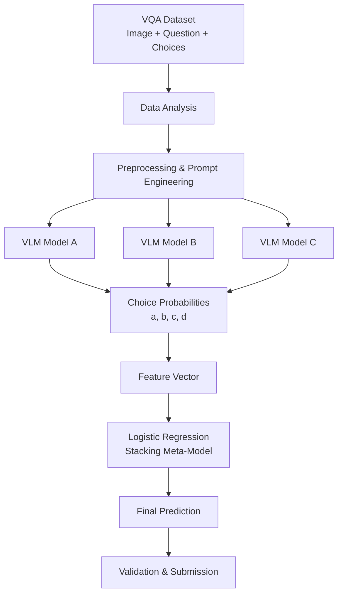

# 🧠 Qwen 기반 VQA 모델 경량화 및 앙상블 성능 개선

> **Qwen Vision-Language Model(VLM)을 활용한 이미지 기반 객관식 질의응답(VQA) 프로젝트**
>
> 4-bit 양자화와 LoRA 파인튜닝으로 모델 학습 효율을 높이고, 데이터 분석 및 Stacking Ensemble을 통해 예측 성능을 개선했습니다.


---

## 🏆 Project Results

| 항목 | 결과 |
|------|------|
| **Kaggle 최종 순위** | **9위 / 약 1,000팀** |
| **검증 정확도** | **0.96 (96%)** |
| 학습 환경 | NVIDIA A100 GPU |
| 모델 경량화 | 4-bit Quantization + LoRA |
| 앙상블 | 3개 VLM + Logistic Regression Stacking |
| 검증 데이터 | 750개 |
| 테스트 데이터 | 750개 |

### 주요 성과

- Qwen 기반 VLM에 4-bit 양자화와 LoRA를 적용하여 GPU 메모리 사용 효율 개선
- 이미지·질문 유형별 오답 패턴을 분석하고 전처리 및 프롬프트 개선
- 3개 VLM의 객관식 선택지별 예측 확률을 활용한 Stacking Ensemble 적용
- 검증 정확도 96% 달성
- Kaggle 약 1,000팀 중 9위 기록

---

## 📌 1. Project Overview

### Background

Visual Question Answering(VQA)은 이미지에 대한 이해와 자연어 질문에 대한 추론을 동시에 요구하는 멀티모달 AI 태스크입니다.

특히 객관식 VQA에서는 이미지의 시각적 특징뿐 아니라 질문의 의도와 선택지 사이의 관계를 정확히 해석해야 합니다.

본 프로젝트에서는 사전 학습된 Vision-Language Model을 기반으로 다음 문제를 해결하고자 했습니다.

1. **GPU 자원 제약**: 대규모 VLM을 제한된 환경에서 효율적으로 학습
2. **추론 정확도**: 이미지 및 질문 유형에 따른 오답 발생
3. **모델별 성능 편차**: 특정 질문 유형에서 개별 모델의 예측 오류 발생
4. **응답 형식 일관성**: 객관식 정답을 a, b, c, d 중 하나로 출력하도록 제어

### Objectives

- Qwen 기반 VLM의 학습 비용 및 메모리 사용량 최적화
- 데이터 특성 분석을 통한 예측 정확도 개선
- 다양한 VLM의 예측 결과를 결합한 앙상블 성능 개선
- Kaggle 평가 데이터에서 높은 일반화 성능 확보

---

## 🛠️ 2. Tech Stack

| Category | Technology |
|----------|------------|
| Language | Python |
| Deep Learning | PyTorch |
| Vision-Language Model | Qwen2.5-VL |
| Model Framework | Hugging Face Transformers |
| Fine-tuning | PEFT, LoRA |
| Quantization | BitsAndBytes, 4-bit NF4 |
| Ensemble | Scikit-learn, Logistic Regression |
| Data Processing | Pandas, NumPy, Pillow |
| GPU | NVIDIA A100 |
| Evaluation | Accuracy, Kaggle Leaderboard |

---

## 🏗️ 3. System Architecture



### Processing Pipeline

**Step 1. Data Analysis**

- 이미지와 객관식 질문의 데이터 구조 분석
- 검증 데이터 오답 패턴 확인
- 질문 및 선택지 유형에 따른 오류 분석

**Step 2. Model Optimization**

- Qwen 기반 VLM 로드
- 4-bit NF4 양자화 적용
- LoRA 기반 Parameter-Efficient Fine-Tuning 수행

**Step 3. Inference**

- 각 VLM에서 선택지 a, b, c, d에 대한 예측 확률 추출
- 모델별 예측 결과를 앙상블 입력 Feature로 변환

**Step 4. Stacking Ensemble**

- 3개 모델의 예측 확률 결합
- Logistic Regression을 Meta-Model로 학습
- 최종 정답 예측

**Step 5. Evaluation**

- 검증 정확도 측정
- 오류 유형 분석
- Kaggle 제출 및 성능 확인

---

## 📊 4. Dataset

### Dataset Configuration

| Dataset | Samples | Purpose |
|---------|---------|---------|
| Validation | 750 | 모델 성능 평가 및 오답 분석 |
| Test | 750 | 최종 예측 및 Kaggle 제출 |

### Data Format

각 데이터는 이미지와 질문, 4개의 선택지로 구성됩니다.

| Column | Description |
|--------|-------------|
| id | 데이터 식별자 |
| path | 이미지 파일 경로 |
| question | 이미지 관련 질문 |
| a | 선택지 A |
| b | 선택지 B |
| c | 선택지 C |
| d | 선택지 D |
| answer | 정답 레이블 (학습/검증 데이터) |

### Example

```text
Image: example.jpg

Question:
What color is the car?

(a) Red
(b) Blue
(c) Green
(d) Yellow

Answer: b
```

모델은 이미지와 질문을 함께 입력받아 최종 정답을 `a`, `b`, `c`, `d` 중 하나로 예측합니다.

---

## ⚡ 5. Model Optimization

### 5.1 4-bit Quantization

대규모 VLM의 GPU 메모리 사용량을 줄이기 위해 BitsAndBytes 기반 4-bit 양자화를 적용했습니다.

```python
from transformers import BitsAndBytesConfig
import torch

bnb_config = BitsAndBytesConfig(
    load_in_4bit=True,
    bnb_4bit_use_double_quant=True,
    bnb_4bit_quant_type="nf4",
    bnb_4bit_compute_dtype=torch.float16,
)
```

**적용 효과**

- 모델 가중치 저장에 필요한 GPU 메모리 부담 감소
- 제한된 GPU 메모리 환경에서도 대규모 VLM 활용 가능
- LoRA와 결합하여 효율적인 파인튜닝 구성

### 5.2 LoRA Fine-Tuning

모델 전체 파라미터를 학습하는 대신, Low-Rank Adapter를 추가하여 일부 파라미터만 학습하도록 구성했습니다.

```python
from peft import LoraConfig

lora_config = LoraConfig(
    r=8,
    lora_alpha=16,
    lora_dropout=0.05,
    bias="none",
    target_modules=[
        "q_proj",
        "k_proj",
        "v_proj",
        "o_proj",
        "gate_proj",
        "up_proj",
        "down_proj",
    ],
    task_type="CAUSAL_LM",
)
```

**적용 효과**

- 학습 가능한 파라미터 수 감소
- GPU 메모리 효율 개선
- 사전 학습된 모델의 표현 능력을 활용하면서 VQA 태스크에 적응

### 5.3 Training Strategy

- 4-bit Quantization + LoRA 적용
- Gradient Checkpointing 활용
- Gradient Accumulation 적용
- Mixed Precision 연산 활용
- AdamW Optimizer 사용

---

## 🔍 6. Data Analysis & Prompt Engineering

### 6.1 Error Analysis

검증 데이터의 오답을 분석하여 모델이 취약한 질문 및 이미지 유형을 파악했습니다.

분석 결과를 바탕으로 입력 데이터의 전처리 방식과 프롬프트를 개선했습니다.

### 6.2 Prompt Engineering

모델이 불필요한 설명을 생성하지 않고 객관식 정답만 출력하도록 지시문을 구성했습니다.

```python
SYSTEM_INSTRUCT = (
    "You are a helpful visual question answering assistant. "
    "Answer using exactly one letter among a, b, c, or d. "
    "No explanation."
)
```

질문과 선택지를 일관된 형식으로 변환했습니다.

```python
def build_mc_prompt(question, a, b, c, d):
    return (
        f"{question}\n"
        f"(a) {a}\n"
        f"(b) {b}\n"
        f"(c) {c}\n"
        f"(d) {d}\n\n"
        "정답을 반드시 a, b, c, d 중 "
        "하나의 소문자 한 글자로만 출력하세요."
    )
```

### 6.3 Prompt Strategy

실험 과정에서 다음과 같은 프롬프트 전략을 검토했습니다.

- **Direct Answer**: 정답만 출력하도록 제약
- **Chain-of-Thought Instruction**: 단계적 추론을 유도하는 지시문
- **Elimination Prompt**: 오답 선택지를 제거하는 방식
- **Few-shot Prompt**: 예시를 활용한 응답 형식 안내

최종적으로 모델의 응답 형식과 검증 데이터의 예측 성능을 고려하여 프롬프트를 개선했습니다.

---

## 🧩 7. Stacking Ensemble

### 7.1 Motivation

단일 VLM은 이미지 유형과 질문의 복잡도에 따라 서로 다른 예측 결과를 생성할 수 있습니다.

이를 보완하기 위해 서로 다른 3개 VLM의 예측 결과를 결합하는 Stacking Ensemble을 적용했습니다.

단순 다수결 대신 모델이 각 선택지에 부여한 예측 확률을 활용했습니다.

### 7.2 Feature Engineering

각 VLM의 선택지별 예측 확률을 Feature로 구성했습니다.

```text
Model A
[a_prob, b_prob, c_prob, d_prob]

Model B
[a_prob, b_prob, c_prob, d_prob]

Model C
[a_prob, b_prob, c_prob, d_prob]

             ↓

Concatenate Probabilities

             ↓

12-dimensional Feature Vector

             ↓

Logistic Regression

             ↓

Final Prediction
```

3개 모델에서 각각 4개의 선택지 확률을 추출하여 총 12차원의 Feature Vector를 구성했습니다.

### 7.3 Meta-Model

Meta-Model로 Logistic Regression을 사용했습니다.

```python
from sklearn.linear_model import LogisticRegression

meta_model = LogisticRegression(
    max_iter=1000,
    random_state=42
)

meta_model.fit(X_train, y_train)

predictions = meta_model.predict(X_valid)
```

위 코드는 Stacking Meta-Model의 핵심 학습 구조를 설명하는 예시입니다.

실제 앙상블에서는 각 모델의 선택지별 예측 확률을 정렬해 입력하고, 검증 데이터의 정답 레이블을 활용하여 최종 예측 모델을 학습합니다.

### 7.4 Expected Advantages

- 여러 VLM의 상호보완적 특성 활용
- 개별 모델의 특정 질문 유형에 대한 오류 완화
- 모델별 예측 확률을 고려한 최종 정답 결정
- 단순 다수결보다 유연한 모델 결합 구조

---

## 📈 8. Evaluation & Results

### Evaluation Metric

객관식 VQA 성능 평가에는 Accuracy를 사용했습니다.

```text
Accuracy = Correct Predictions / Total Predictions
```

### Final Results

| Metric | Result |
|--------|--------|
| Validation Accuracy | **0.96** |
| Kaggle Ranking | **9th / ~1,000 Teams** |
| Quantization | 4-bit NF4 |
| Fine-tuning | LoRA |
| Ensemble | Logistic Regression Stacking |

### Key Achievements

**1. Efficient Model Training**

4-bit 양자화와 LoRA 파인튜닝을 결합하여 대규모 VLM의 학습 부담을 줄였습니다.

**2. Data-driven Improvement**

검증 데이터의 오답 유형을 분석하고, 이를 바탕으로 전처리와 프롬프트를 개선했습니다.

**3. Ensemble Performance Improvement**

3개 VLM의 예측 확률을 결합하는 Stacking Ensemble을 적용하여 개별 모델의 예측 결과를 종합했습니다.

**4. Competition Performance**

검증 정확도 96%를 기록하고 Kaggle 약 1,000팀 중 9위를 달성했습니다.

---

## 📁 9. Repository Structure

```text
AI_CH/
│
├── README.md
│
├── train.csv
├── test.csv
├── sample_submission.csv
├── submission.csv
│
├── train/
│   └── ...
│
├── test/
│   └── ...
│
├── changuk_model/
│   ├── adapter_config.json
│   ├── adapter_model.safetensors
│   └── ...
│
├── ccu/
│   ├── bgg.py
│   ├── ccu.py
│   └── qwen2_5_vl_3b_lora/
│
├── bgg.py
├── ccu.py
└── syb.py
```

### Main Files

| File / Directory | Description |
|------------------|-------------|
| `bgg.py` | Qwen2.5-VL 기반 양자화·LoRA 학습 및 추론 |
| `ccu.py` | 모델 학습 및 실험 코드 |
| `syb.py` | VQA 모델 실험 코드 |
| `ccu/` | 추가 모델 및 앙상블 실험 |
| `changuk_model/` | Qwen2.5-VL-7B LoRA Adapter |
| `train/` | 학습 이미지 |
| `test/` | 테스트 이미지 |
| `submission.csv` | Kaggle 제출 파일 |

---

## 🚀 10. Getting Started

### Clone Repository

```bash
git clone https://github.com/AI-Challenge-SCG/AI_CH.git
cd AI_CH
```

### Install Dependencies

```bash
pip install torch torchvision
pip install transformers accelerate bitsandbytes
pip install peft
pip install pandas numpy pillow
pip install scikit-learn tqdm
```

패키지 버전과 CUDA 환경에 따라 추가적인 의존성 조정이 필요할 수 있습니다.

### Training & Inference

저장소의 `bgg.py`는 Qwen2.5-VL-3B 기반 LoRA 학습과 테스트 데이터 추론을 포함합니다.

```bash
python bgg.py
```

실행 전 다음 사항을 확인해야 합니다.

- CUDA를 사용할 수 있는 GPU 환경
- 모델 다운로드에 필요한 Hugging Face 접근 환경
- CSV의 이미지 경로와 실제 이미지 파일 경로 일치
- 사용 가능한 GPU 메모리
- 학습 스크립트의 데이터 샘플링 및 하이퍼파라미터 설정

**Note:** 저장소에는 다양한 실험 버전의 코드가 포함되어 있으며, 전체 Stacking Ensemble 파이프라인을 단일 명령으로 재현하는 실행 스크립트는 별도로 확인이 필요합니다.

---

## 💡 11. Lessons Learned

### Parameter-Efficient Fine-Tuning

대규모 멀티모달 모델을 활용할 때 모든 파라미터를 재학습하지 않더라도, 양자화와 LoRA를 통해 제한된 자원에서 효율적인 학습 환경을 구축할 수 있었습니다.

### Importance of Error Analysis

모델 아키텍처의 변경뿐 아니라 데이터 유형별 오답 분석과 프롬프트 개선 역시 VQA 성능 향상에 중요한 요소임을 확인했습니다.

### Ensemble Learning

개별 모델의 최종 예측값뿐 아니라 선택지별 확률 분포를 Feature로 활용하면, 여러 VLM의 정보를 종합하는 학습 기반 앙상블을 구성할 수 있습니다.

### End-to-End AI Development

데이터 분석부터 모델 경량화, 파인튜닝, 추론, 앙상블, 성능 평가까지 멀티모달 AI 모델의 전체 개발 과정을 경험했습니다.

---

## 🔗 Repository

**GitHub:** https://github.com/AI-Challenge-SCG/AI_CH

**Project:** Qwen-based Visual Question Answering

**Keywords:** `VLM` `VQA` `Qwen2.5-VL` `PyTorch` `LoRA` `4-bit Quantization` `Stacking Ensemble` `Logistic Regression` `Kaggle`
